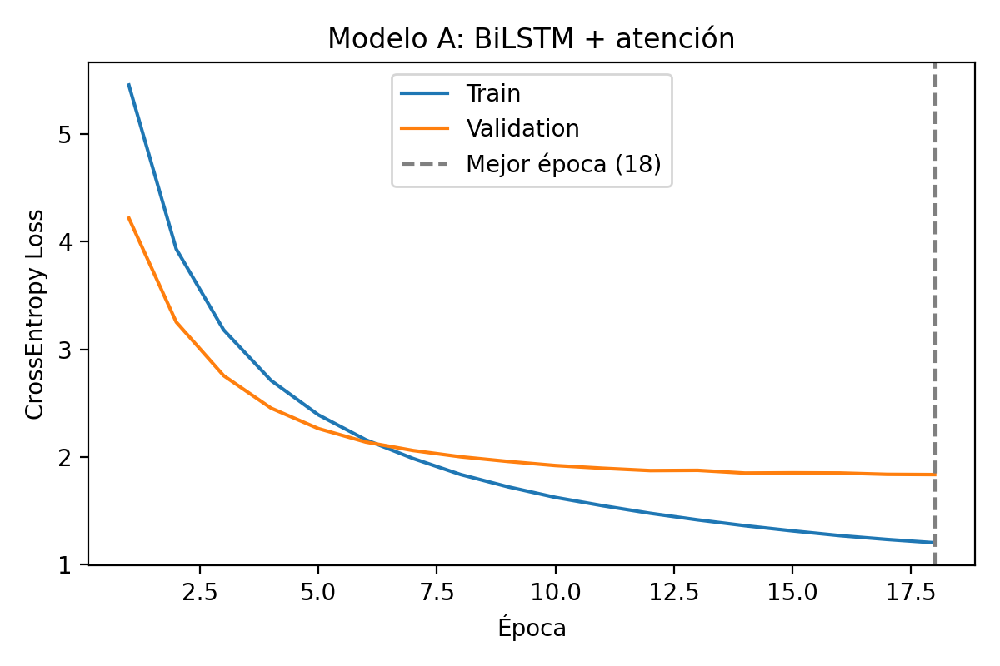

# PROYECTO FINAL INTEGRADOR: De Cero a Preentrenado: Evaluación Comparativa de Arquitecturas Sequence-to-Sequence en Machine Translation Neuronal

**Integrantes 1: Ian Roberto Rendón Berlanga - A01384161**
**Integrante 2: Gustavo Axel Huerta García - A00574308**

## Objetivo
El objetivo del proyecto es construir cuatro arquitecturas de aprendizaje profundo para la tarea de **Traducción Automática Neuronal (NMT)** del inglés al español (EN \rightarrow ES). A través de este estudio empírico, el equipo analizará el impacto del sesgo inductivo secuencial frente a los mecanismos de autoatención pura desde cero y la ganancia obtenida mediante Transfer Learning y ajuste fino (*Fine-Tuning*) a partir de los modelos preentrenados a gran escala.

## Auditoría de datos

**Corpus:** pares paralelos Inglés–Español de Tatoeba/ManyThings (`spa.txt`).
**Protocolo:** se usó sin modificaciones el bloque oficial de carga, filtrado y partición del enunciado.

| Parámetro | Valor |
|---|---|
| Filtro | ≥ 8 palabras en inglés, ≤ 120 palabras en ambos idiomas |
| Mezcla | determinista, `random.Random(23)` |
| Partición | 80 % Train / 10 % Validation / 10 % Test |
| Pares tras el filtro | 36 413 |

| Partición | Muestras |
|---|---|
| Train | 29 130 |
| Validation | 3 641 |
| Test | 3 642 |

**SHA-256 Test Audit ID:** `dbac04ac5648`
Cada notebook repite el bloque de partición y verifica este ID con un `assert`, así que cualquier cambio en el filtro, la semilla o el archivo hace fallar la ejecución.

### Prevención de fuga de datos

- Los vocabularios (`eng_word2idx`, `spa_word2idx`) se construyen **solo con `train_pairs`**.
- Las palabras de validación y test que no están en el vocabulario de entrenamiento se mapean a `<unk>`.
- `test_pairs` no se usa para entrenar, ajustar hiperparámetros, elegir épocas ni hacer early stopping; solo se usa en la evaluación final.
- La normalización (minúsculas, sin acentos, sin puntuación) usa una única función, `clean_text`, aplicada igual al entrenamiento y al cálculo de BLEU de los cuatro modelos.

### Vocabularios y palabras desconocidas

Vocabularios con frecuencia mínima de 2 (incluyen `<pad>`, `<unk>`, `<sos>`, `<eos>`):

| | Inglés | Español |
|---|---|---|
| Tamaño del vocabulario | 5 453 | 8 027 |
| `<unk>` en train | 1.17 % | 2.71 % |
| `<unk>` en validation | 1.96 % | 4.39 % |
| `<unk>` en test | 2.07 % | 4.37 % |

Las tasas de `<unk>` son mayores en validation y test porque el vocabulario se construye solo con train.

### Limitación conocida: oraciones repetidas entre train y test

Tatoeba contiene varias traducciones al español para una misma oración en inglés. Como resultado, **564 de 3 642 oraciones de test (15.5 %)** tienen una fuente en inglés que también aparece en train (con otra traducción posible al español). La partición no se modificó, por requerimiento del protocolo. Esto puede favorecer a los modelos con mayor capacidad de memorización, por lo que en la evaluación se reporta, además de la tabla oficial, el BLEU sobre el subconjunto de test cuya fuente no aparece en train.

## Modelo A: BiLSTM Encoder–Decoder con atención (desde cero)

**Implementación:** PyTorch, en `src/models_a.py`. Notebook: `notebooks/01_modelo_A_bilstm_atencion.ipynb`.

### Arquitectura

- **Encoder:** embedding (`padding_idx=0`) + `nn.LSTM` bidireccional de 1 capa, con `pack_padded_sequence` / `pad_packed_sequence` para ignorar el padding.
- **Puente:** los estados finales forward y backward (2H) se concatenan y se proyectan a H (capa lineal + `tanh`) para inicializar el decoder.
- **Atención de producto punto (estilo Luong):** las salidas del encoder se proyectan a la dimensión del decoder; los scores se enmascaran en las posiciones de padding antes del softmax. El contexto se calcula como `c_i = Σ_j α_ij h_j^e`.
- **Decoder:** LSTM autorregresivo de 1 capa; se combinan `[c_i ; h_i]` con una capa lineal + `tanh`, y una capa final produce los logits sobre el vocabulario en español.
- **Entrenamiento:** teacher forcing, con el target desplazado un paso (`tgt_in` / `tgt_out`).

### Hiperparámetros

| Parámetro | Valor |
|---|---|
| Embedding / hidden | 256 / 256 |
| Dropout | 0.3 |
| Optimizador | Adam, lr = 1e-3 |
| Gradient clipping | 1.0 |
| Batch | 64 (agrupado por longitud) |
| Precisión | mixed precision (fp16) |
| Pérdida | CrossEntropy, `ignore_index=0`, promediada por token |
| Early stopping | paciencia 5 sobre `val_loss` (máx. 30 épocas) |
| Semilla | 23 |
| **Parámetros entrenables** | **7,683,419** |

### Resultados de entrenamiento

| Métrica | Valor |
|---|---|
| Mejor época | 18 |
| Train loss en la mejor época | 1.2022 |
| Val loss (mejor) | 1.8355 (perplejidad ≈ 6.3) |
| Parada por early stopping | época 23 |
| Tiempo por época (GPU) | ≈ 8 s |

**Diagnóstico:** la validación converge hacia la época 18 y se mantiene plana (≈ 1.83–1.85) hasta el final, mientras la pérdida de entrenamiento sigue bajando hasta 1.06. La brecha entre ambas crece de casi 0 (época 7) a ≈ 0.8 (época 23), señal de sobreajuste moderado. Para la evaluación se usa el checkpoint de la mejor época (`modeloA_best`). La pérdida de train se mide con dropout activo y la de validación sin él.

### Verificación preliminar en validación

Evaluación rápida con decodificación greedy (`max_len = 60`) sobre las primeras 500 oraciones de **validación** (el conjunto de test no se ha usado):
- Las oraciones con fuente repetida en train inflan ligeramente el BLEU (≈ 1.4 puntos: 35.94 vs 34.54).
- 
| Conjunto | BLEU (sacrebleu) |
|---|---|
| 500 oraciones de validación | 35.94 |
| Solo oraciones cuya fuente no aparece en train (432/500) | 34.54 |

- 159 tokens `<unk>` aparecen en las salidas (3.3 % de las palabras generadas). Para el BLEU, `<unk>` se reemplaza por `unk` antes de evaluar, de modo que cada token desconocido cuente como un solo error. Sin esa regla, `sacrebleu` lo divide en tres tokens (`<`, `unk`, `>`), lo que infla la longitud de la hipótesis y penaliza el BLEU (33.77 sin la regla). La misma regla se aplica a los modelos A, B y C.

- Las oraciones con fuente repetida en train inflan ligeramente el BLEU (≈ 1.3 puntos).
- 159 tokens `<unk>` aparecen en las salidas (3.3 % de las palabras generadas). La regla de conteo de `<unk>` para el BLEU final se fijará en la evaluación del Día 5.

Ejemplos (validación, texto normalizado):

| | Texto |
|---|---|
| EN | Tom told me he was able to speak three languages. |
| Referencia | tom me dijo que era capaz de hablar tres idiomas |
| Modelo A | tom me dijo que estaba capaz de hablar tres idiomas |
| EN | I looked for the key under the welcome mat and in the nearby flower pot. |
| Referencia | busque la llave bajo la alfombra de bienvenida y en la maceta de al lado |
| Modelo A | busque por la llave debajo del rio `<unk>` y en el cruce `<unk>` |

El primer ejemplo muestra una confusión ser/estar; el segundo, el efecto de las palabras raras (`welcome mat`, `flower pot`) en un vocabulario a nivel de palabra, que caen en `<unk>` y llevan al decoder a generar texto incorrecto.

> Estos resultados son preliminares y de validación. La evaluación oficial en test (Tabla 1) se hará una sola vez, tras entrenar los cuatro modelos.

## Estado del proyecto

| Componente | Estado |
|---|---|
| Datos, protocolo y auditoría (SHA-256) | Completado |
| Modelo A: BiLSTM + atención | Entrenado |
| Modelo B: Transformer compacto | Pendiente |
| Modelo C: Transformer base | Pendiente |
| Modelo D: fine-tuning | Pendiente |
| Evaluación en test y Tabla 1 | Pendiente |
